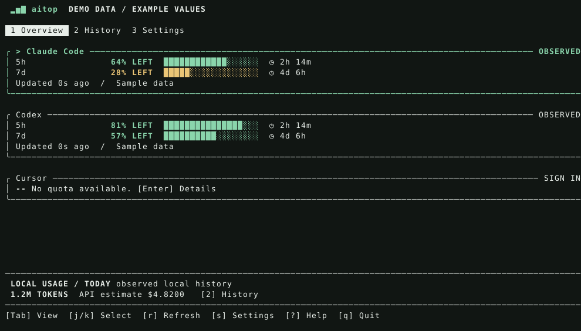

# aitop

**AI 코딩 도구의 한도와 로컬 사용 이력을 터미널 한곳에서 확인합니다.**

잔여 쿼터, 리셋 시간, 프로젝트·모델별 토큰 이력을 보여줍니다. 출처와 관측 시각을 표시하며 조회할 수 없는 값을 0이나 잔량 100%로 바꾸지 않습니다.

[English](README.md) · [서비스별 지원 범위](docs/providers.md) · [데이터·비용·개인정보](docs/data.md)



[서비스 상세 미리보기](assets/details.svg) · [일별 잔디 미리보기](assets/detail-calendar.svg) · [사용량·달러 통계 미리보기](assets/detail-usage.svg) — 예시 데이터로 렌더링한 화면입니다.

현재 버전은 **0.2.0-alpha.5 소스 프리뷰**입니다. 비식별 fixture로 핵심 동작을 검증하며, 실계정의 모든 플랜·버전 호환성을 보증하지 않습니다. 아직 게시된 Homebrew Formula와 릴리스 바이너리는 없습니다.

## 설치와 실행

최신 stable Rust가 필요합니다. macOS와 Linux를 우선 대상으로 하며 Windows 정식 지원은 보류했습니다.

```sh
git clone https://github.com/jsha2217/aitop.git
cd aitop
cargo install --path . --locked
aitop demo
aitop
```

`demo`는 실제 설정·인증·이력을 읽거나 바꾸지 않는 예시 데이터 모드입니다. 일반 실행은 도구 디렉터리를 탐지하며 Keychain을 자동 조회하지 않습니다. `s`에서 표시할 도구와 연결 상태를 확인하세요.

## 주요 기능

- 대시보드·이력·설정을 갖춘 하나의 반응형 TUI
- 잔량/사용량 게이지, 리셋 카운트다운, 오래된 데이터·오류 표시
- 오늘·7일·30일의 프로젝트·모델·도구별 로컬 사용량
- 증분 JSONL 수집, SQLite 인덱스, 중복 기록 처리
- 텍스트·JSON·오프라인 조회·진단·tmux용 캐시 요약
- ASCII·무색상 모드, 키보드 탐색, 좁은 터미널 대응

개인 금액 예산, 별도 주간 요약, 캐시 효율 분석은 개편 범위에서 제외했습니다. 소진 예측·실시간 활동 세션·다중 계정 화면은 도입 보류 상태입니다. 임계치 알림은 아직 구현되지 않았습니다.

## 서비스별 지원

| 서비스 | 쿼터 | 토큰 이력 |
|---|---|---|
| Claude Code | statusline 캡처, 실험적 OAuth·명시적 Keychain 조회 | 로컬 assistant usage |
| Codex | 로그 스냅샷, 실험적 OAuth, 선택적 App Server | 로컬 누적·증분 usage |
| Antigravity | 선택적 실험 CLI, 지원 스키마만 파싱 | 시각과 usage가 있는 구조화된 기록 |
| Cursor | 실험적 프로필 API, 정확한 필드가 있어야 표시 | 미지원 |
| GitHub Copilot | 기존 CLI 인증 기반 실험적 내부 API | 미지원 |
| Grok | 검증된 소스 없음, 잔량 추정 안 함 | 시각과 usage가 있는 구조화된 기록 |

위 표는 구현된 파서의 범위이며 실계정 호환성 인증표가 아닙니다. 지원하지 않는 응답은 미확인으로 표시합니다. 구체적인 형식과 제약은 [서비스 가이드](docs/providers.md)에 있습니다.

## 명령어와 단축키

```sh
aitop --once
aitop status --provider codex --json
aitop history --period 7d --group-by project
aitop history --period 30d --group-by model
aitop status --offline
aitop doctor
aitop providers
aitop config set codex true
aitop -i 60
aitop statusline --cached
```

`-i`의 갱신 주기 저장 동작은 유지했습니다. AGY가 활성화돼 있으면 별도 실행 옵션 없이 읽기 전용 CLI 조회를 실행합니다. `--agy-cli`는 이전 실행 명령과의 호환성을 위해 유지합니다. `--cli`는 Codex를 기본 API 대신 App Server로 조회하도록 선택합니다. macOS의 `--keychain`은 Claude 자격 증명 조회를 명시적으로 허용하고 이후 실행에도 적용되도록 저장합니다. OS 권한 창이 나타날 수 있습니다. 설정의 Claude Keychain 항목이나 `aitop config set claude_keychain false`로 해제할 수 있습니다. `--offline`은 벤더 요청과 CLI 조회를 모두 막습니다.

| 키 | 동작 |
|---|---|
| `1/2/3`, `Tab` | 대시보드·이력·설정 전환 |
| `j/k`, 방향키 | 항목 선택·스크롤 |
| `Enter` | 선택 도구 상세 또는 설정 변경 |
| 상세의 `↑/↓`, PageUp/PageDown, Home/End | 상세 스크롤 |
| 상세의 `←/→`, `p`, `c` | 서비스 변경, 기간 변경, 토큰/달러 그래프 전환 |
| 상세의 `2`, 이력의 `f` | 해당 서비스 이력 열기, 서비스 필터 변경 |
| `[` / `]`, `{` / `}`, `0` | 잔디 날짜 이동, 주 단위 이동, 오늘로 복귀 |
| `p/g` | 이력의 기간·집계 기준 변경 |
| `r`, Space | 캐시 대기를 건너뛰고 전체 즉시 조회, 자동 갱신 정지·재개 |
| `s`, `?` | 설정, 도움말 |
| `q`, Esc, Ctrl-C | 종료; Esc는 열린 상세·도움말·설정을 먼저 닫음 |

설정의 자동 갱신 간격은 `30초·1분·3분·5분·10분·15분`이며, 화면에는 `30s·1m·3m·5m·10m·15m`으로 표시합니다. 설정 화면에서도 `1/2/3`, `Tab`으로 화면을 전환할 수 있습니다. 변경한 설정은 즉시 저장됩니다.

`--ascii`, `--no-color`, `NO_COLOR`는 현재 실행에만 적용되며 다른 설정을 저장할 때 함께 저장되지 않습니다. `aitop --color`로 현재 실행의 색상을 강제로 켤 수 있습니다. 기본 색상 설정은 설정 화면 또는 `aitop config set no_color false`로 변경합니다.

tmux는 실행 중인 aitop 또는 주기적인 `aitop --once`가 만든 캐시를 읽습니다. 상태줄 호출마다 로그를 스캔하거나 네트워크를 호출하지 않으며 숨은 상주 서비스를 만들지 않습니다.

```tmux
set -g status-right '#(aitop statusline --cached)'
```

히스토리에는 활성화된 모든 에이전트의 토큰을 합산한 **통합 잔디**, 에이전트 상세에는 **개별 잔디**를 표시합니다. 최근 365일을 집계하며 화면 너비에 따라 보이는 기간이 달라집니다. 회색 칸은 수집 기록이 없는 날짜이고, 초록색 4단계는 날짜별 토큰 양을 나타냅니다. 날짜를 선택하면 정확한 토큰 수를 볼 수 있습니다. 히스토리 표의 서비스 필터를 바꿔도 통합 잔디는 전체 범위를 유지합니다.

`r`은 자체 캐시의 대기 시간을 건너뛰고 실제 조회를 요청합니다. 이미 수동 조회 중이라면 중복 실행하지 않고, 자동 수집 중이라면 완료 직후 수동 조회를 한 번 실행합니다.

## 수치의 의미

쿼터는 공급자/도구가 보고한 관측값입니다. 리셋 시각이 지났다고 잔량을 자동으로 100%로 바꾸지 않습니다. 마지막 정상 값을 보존하는 경우 오류와 관측 시각을 함께 표시합니다.

토큰은 이 컴퓨터에서 읽은 지원 기록의 합입니다. 다른 기기·삭제된 기록·미지원 형식은 포함하지 않습니다. 프로젝트는 이름과 짧은 해시로 구별하고 전체 경로는 출력하지 않습니다. 손상된 기록이나 미완성 줄이 있으면 부분 집계로 표시합니다.

비용은 구독 청구액이 아닌 **API 환산 추정치**입니다. 등록된 Claude·Codex 모델은 기본 공식 단가표(2026-11-08 확인)로 자동 계산합니다. `~/.config/aitop/prices.json`은 단가를 덮어쓸 때만 선택적으로 사용합니다. 가격을 모르는 이벤트가 있으면 전체 비용은 `null`로 유지하고 확인된 소계는 `$금액 + ?`로 표시합니다. 토큰은 계속 표시합니다. 자세한 내용은 [데이터 문서](docs/data.md)를 참고하세요.

Enter 상세에서는 모든 한도 게이지와 리셋 날짜·시각을 유지하면서 **오늘·7일·30일 토큰/달러 합계**, 입력·출력·캐시 구성, 최근 24시간 그래프, 모델·프로젝트 상위 3개를 함께 봅니다. 일부 단가만 확인되면 `$금액 + ?`로 부분 금액임을 표시하며, 단가가 모두 없으면 미확인으로 둡니다. `c`로 시간별 토큰/달러 그래프를 바꿀 수 있습니다. 이 통계는 이 기기의 기록을 환산한 값이며 실제 청구액이나 구독 잔액이 아닙니다.

JSON은 schema version 1이며 인증 토큰을 포함하지 않습니다. 종료 코드는 성공 `0`, 요청 결과의 부분 실패·미확인 `1`, 인자·설정 오류 `2`입니다.

## 문제 해결과 저장 위치

아무것도 보이지 않으면 `s` 또는 `aitop config set <도구> true`로 활성화합니다. 조회가 안 되면 `aitop doctor`와 서비스 가이드를 확인하세요. 원본 대화 로그나 인증 정보를 이슈에 올리지 마세요.

- 설정: `~/.config/aitop/config.json`
- 파생 이력·쿼터 캐시: `~/.cache/aitop/`
- 손상된 설정은 덮어쓰지 않습니다.
- 로그·대화·코드·인증 토큰은 데이터베이스에 저장하지 않습니다.
- 텔레메트리·중계 서버·브라우저 쿠키 수집을 사용하지 않습니다.
- 캐시 자동 보관 기간·삭제 기능은 아직 없으며 수동으로 관리합니다.

개발·검증·릴리스 준비는 [영문 README](README.md#development-and-releases), [기여 안내](CONTRIBUTING.md), [릴리스 안내](docs/releasing.md)에 정리했습니다. MIT 라이선스입니다.
