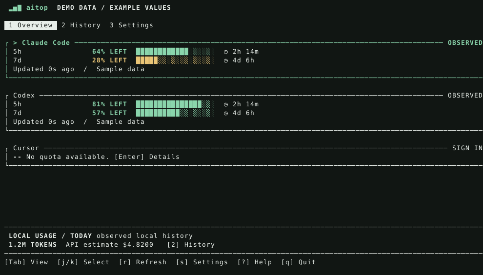

# aitop

**AI coding quotas and local usage, in your terminal.**

See remaining limits, reset times, and project-level token history. Every quota has a source and observation time. Missing data stays missing.

[한국어](README.ko.md) · [Provider support](docs/providers.md) · [Data and privacy](docs/data.md) · [Changes](CHANGELOG.md)



[Provider detail preview](assets/details.svg) · [Daily calendar preview](assets/detail-calendar.svg) · [Usage and dollar statistics preview](assets/detail-usage.svg) (synthetic demo data)

**0.2.0-alpha.5 — source preview.** Core behavior is tested with synthetic fixtures. Live account compatibility is not certified. This repository does not yet provide a published Homebrew formula or hosted release binaries.

## Install

Requires a current stable Rust toolchain. macOS and Linux are the initial targets; Windows support is deferred.

```sh
git clone https://github.com/jsha2217/aitop.git
cd aitop
cargo install --path . --locked
aitop demo
```

Then run `aitop` to inspect your local tools. No aitop account is needed. The first run detects tool directories without accessing Keychain. Use **s** to choose providers and see connection details.

For local development: `cargo run --locked -- demo`.

## What it does

- One responsive TUI with **Overview**, **History**, and combined **Settings / Connections**.
- Quota windows with remaining/used percentages, live countdowns, stale indicators, and explicit failures.
- Today, 7-day, and 30-day local token history, grouped by project, model, or provider.
- SQLite-backed incremental JSONL indexing, duplicate handling, and bounded record sizes.
- Text, schema-versioned JSON, offline reads, local diagnostics, and a cache-only tmux summary.
- ASCII and no-color modes. No required icon font.

It does not infer subscription quotas from tokens or dollars. It does not execute coding tasks, switch accounts, track a dollar budget, or predict exhaustion times.

## Support is per feature

| Tool | Quota source | Local token history |
|---|---|---|
| Claude Code | Captured statusline; experimental OAuth credential file or explicit Keychain opt-in | Assistant usage records in project JSONL |
| Codex | Local rate-limit snapshots; experimental OAuth; opt-in App Server | Cumulative and legacy usage events in session JSONL |
| Antigravity | Opt-in experimental structured CLI adapter; unrecognized reports stay unavailable | Timestamped structured usage records only |
| Cursor | Experimental legacy profile adapter; exact usage and limit fields required | Unsupported |
| GitHub Copilot | Experimental internal quota API using existing CLI login | Unsupported |
| Grok | No verified source; no quota fabricated | Timestamped structured usage records only |

These are **implemented parsers**, not a promise that a vendor still supplies every field for every plan. The [source guide](docs/providers.md) lists exact accepted formats and limitations. Experimental endpoints can change independently of aitop.

## Everyday commands

```sh
aitop                              # TUI; text summary when stdin/stdout is not a terminal
aitop --once                       # one report, with partial failures signaled by exit code
aitop status --provider codex --json
aitop history --period 7d --group-by project
aitop history --period 30d --group-by model --json
aitop status --offline             # local logs and stored quotas; no vendor calls
aitop doctor                       # local config/storage/source checks; no credential output
aitop providers
aitop demo --once                   # synthetic data; does not touch your settings or history
aitop statusline --cached           # reads quota cache only; no scan, subprocess, or network
```

Enabled AGY providers query their CLI automatically; no extra launch option is needed. `--agy-cli` remains accepted for older launch commands. `--cli` selects `codex app-server` instead of Codex's default API source. `--keychain` explicitly permits the Claude credential lookup on macOS and saves that permission for later launches, which may involve an OS permission prompt. You can revoke it in Settings under Claude Keychain or with `aitop config set claude_keychain false`. Codex App Server and Keychain access are not enabled implicitly. The provider CLI owns its authentication behavior; it may perform normal credential maintenance. `--offline` disables probes and vendor HTTPS requests.

For tmux, first run aitop so that it can populate its cache, then use:

```tmux
set -g status-right '#(aitop statusline --cached)'
```

This is a cached view; a running aitop or periodic `aitop --once` refreshes it. It never starts a hidden background service.

## Keys

| Key | Action |
|---|---|
| `1` / `2` / `3`, `Tab` | Overview / History / Settings |
| `j` / `k`, arrows | Select and scroll |
| `Enter` | Provider details; edit the selected setting |
| `Up/Down`, `PgUp/PgDn`, `Home/End` in details | Scroll the full-width detail view |
| `Left/Right`, `p`, `c` in details | Provider, period, token/USD graph |
| `2` in details; `f` in History | Open this provider's History; cycle service filter |
| `[` / `]`, `{` / `}`, `0` | Calendar: previous/next day, previous/next week, today |
| `p` / `g` in History | Cycle period / grouping |
| `r` | Query all enabled providers now, bypassing the local cache |
| `Space` | Pause/resume automatic refresh |
| `s` | Settings; return from Settings |
| `?` | Help |
| `q`, `Esc`, `Ctrl-C` | Quit (`Esc` first closes help/details/settings) |

Settings save immediately. The refresh presets are `30s`, `1m`, `3m`, `5m`, `10m`, and `15m`; `1/2/3` and `Tab` switch views from Settings too. `aitop -i 60` still persists the interval, as in 0.1. Automatic refresh reuses cached observations and retry delays. Manual `r` requests a live query immediately; a manual query already in flight is not duplicated. Offline mode remains local.

```sh
aitop config
aitop config set codex true
aitop config set refresh_interval 60
aitop config set bar_mode remaining
aitop --ascii --no-color
aitop --color
```

Display flags and `NO_COLOR` affect only the current run and are never saved with unrelated configuration changes. Use `--color` to override `NO_COLOR` or a saved monochrome preference for one run. Change saved preferences in Settings or with `aitop config set no_color false`.

## Reading the numbers

**Quotas:** vendor/tool observations, not estimates based on API prices. A passed reset time shows “recheck needed”; it does not refill the bar automatically. A failed refresh can preserve a last-known observation, with an explicit error.

**Token history:** accepted local records only. Other devices, deleted logs, unsupported events, and unidentifiable account ownership are outside the report. Projects use a basename and short hash to avoid exposing full paths and distinguish equal names. Damaged records and incomplete tails make coverage partial.

**Costs:** API-equivalent estimates, separate from subscription charges. Recognized Claude/Codex models are priced automatically using the bundled official-rate catalog verified on 2026-11-08. Exact-model overrides in `~/.config/aitop/prices.json` are optional. Unknown models remain unpriced, and known subtotals are displayed as `$amount + ?`. See [Data and pricing](docs/data.md) for assumptions and coverage.

**Daily calendar:** History combines tokens from all enabled providers, even when the table is filtered. Provider details show only that provider. Gray squares mean no indexed local usage; four green levels represent increasing daily token totals. The calendar holds 365 local dates and adapts the visible range to the terminal width. Use `[` / `]` to inspect dates, `{` / `}` for weeks, and `0` for today. Selection reveals the exact token count.

**Provider details:** all quota gauges, remaining/used percentages, local reset timestamps, today/7d/30d token and USD summaries, token categories, a recent 24-hour token/USD graph, and top models/projects. A partial dollar subtotal is marked `$amount + ?`; missing rates never produce a zero-dollar bar. These statistics cover indexed local logs, not an account-wide billing ledger. Scroll with the arrows or PageUp/PageDown; `2` opens filtered History.

**JSON:** `schema_version: 1`; unknown counts/costs are `null`, missing quota windows are empty arrays. Usage token counts are included; authentication tokens are never emitted. Exit codes: `0` success, `1` partial/unavailable requested results, `2` arguments/configuration errors. History-only commands do not query quotas. Demo always uses synthetic data.

## Troubleshooting

- **Nothing appears:** enable tools with `s` or `aitop config set codex true`.
- **Claude says sign-in required:** capture statusline observations or explicitly use `--keychain`; see the [Claude guide](docs/providers.md#claude-code).
- **A quota is stale:** its source has not supplied a new observation. Refresh or check the provider's own login. Offline mode does not make old values fresh.
- **Costs are unavailable:** check the model ID and bundled catalog coverage; exact-model overrides are optional. This does not affect token history.
- **A configuration is damaged:** aitop preserves it and reports the problem; repair the file. It never silently resets it.
- **A provider changed format:** run `aitop doctor` and report the version, OS, and sanitized symptom. Do not attach credentials or whole conversation logs.

Settings remain in `~/.config/aitop/config.json`. Derived history and normalized quota caches live in `~/.cache/aitop/`. `--home` and `--data-dir` allow isolated fixtures or portable data locations. The database is a derived index; it never modifies vendor logs. Retention is currently manual—there is no automatic pruning.

## Development and releases

```sh
cargo fmt --all -- --check
cargo clippy --locked --all-targets -- -D warnings
cargo test --locked
cargo run --locked --example render_demo > assets/dashboard.svg
cargo run --locked --example render_demo -- settings > assets/settings.svg
```

CI covers macOS and Linux. [Release packaging](docs/releasing.md) prepares archives and checksums; publishing and Homebrew hosting are separate steps. [Contributing](CONTRIBUTING.md) explains fixture-based provider changes.

MIT license. No telemetry, aitop account, browser-cookie scraping, or intermediary backend. Vendor credentials are used only for direct queries to the configured built-in provider; HTTP redirects are disabled. See [Data and privacy](docs/data.md).
